<h1 align="center"> Rafael Felisberto</h1>

  <b>Computer Science Student</b> • <b>AI & Data Science</b> • <b>Cybersecurity</b>

  Building intelligent systems, exploring security, and turning data into insight.

---

## 👨‍💻 About Me

-  Computer Science student  
-  Passionate about **Artificial Intelligence** & **Machine Learning**  
-  Strong interest in **Cybersecurity**, **OSINT**, and **Malware Analysis**  
-  Data-driven mindset with hands-on projects  
-  Always learning, experimenting, and building real solutions  

---

## 🛠️ Tech Stack

  

## 🔍 What I’m Working On
-  AI Systems – Applied solutions to real-world problems

-  Cybersecurity – OSINT automation & malware behavior analysis

-  Data Science – End-to-end pipelines (ETL, analysis, visualization)

-  Automation – Tools combining Python + AI + Security

## 📊 GitHub Activity — Across Repositories

Public commits, pull requests, reviews, and contributions across repositories I own **and** projects maintained by others.

  

  

  Language percentages describe repository code, not only code authored by me. Private projects may not be included.

  <a href="https://github.com/search?q=author%3ARafaFelisberto&type=commits">Public commits</a> •
  <a href="https://github.com/pulls?q=is%3Apr+author%3ARafaFelisberto">Pull requests</a> •
  <a href="https://github.com/pulls?q=is%3Apr+reviewed-by%3ARafaFelisberto">Reviews</a>

## 🎯 Goals

-  Merge AI + Cybersecurity in practical tools

-  Build models from first principles

-  Create projects with real-world impact

-  Continuously improve as an engineer and researcher

## 🌐 Connect With Me

  &nbsp;&nbsp;  
 
 
